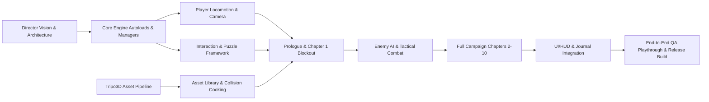

# AGENT TASK GRAPH & SUB-AGENT RESPONSIBILITIES

---

## 1. Production Roles & Sub-Agent Division

1. **Game Director Agent:** Vision enforcement, holistic gameplay feel, final acceptance criteria.
2. **Technical Director Agent:** Godot engine architecture, autoload singletons, physics stability.
3. **Gameplay & Player Agent:** Third-person controller, locomotion state machine, camera, climbing & mantling.
4. **Tripo3D Asset Agent:** Prompt generation, API task monitoring, model optimization, LOD and collision generation.
5. **Level & Environment Agent:** Level blockout, modular scene assembly, lighting, foliage MultiMesh systems.
6. **Narrative & UI Agent:** Screenplay scripts, dialogue subtitles, HUD, journal, main menu & settings.
7. **QA & Playtest Agent:** Automated headless playtests, scenario reproduction, regression test loops.

---

## 2. Dependency Graph

